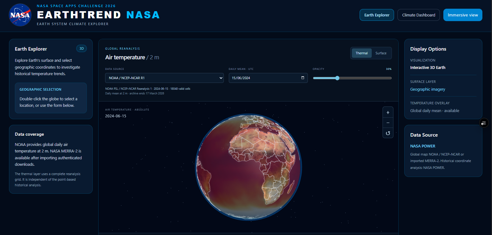
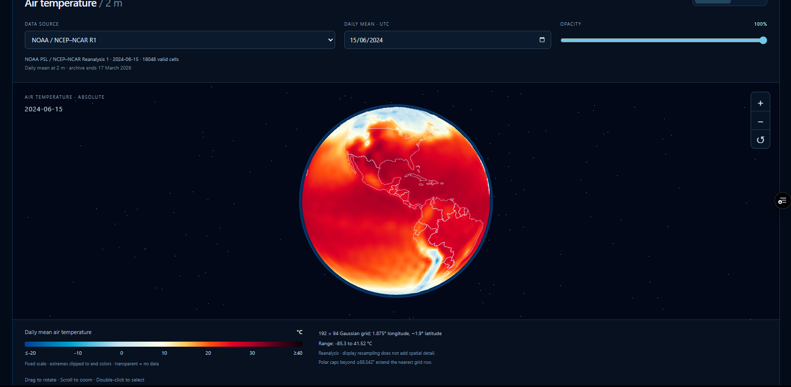
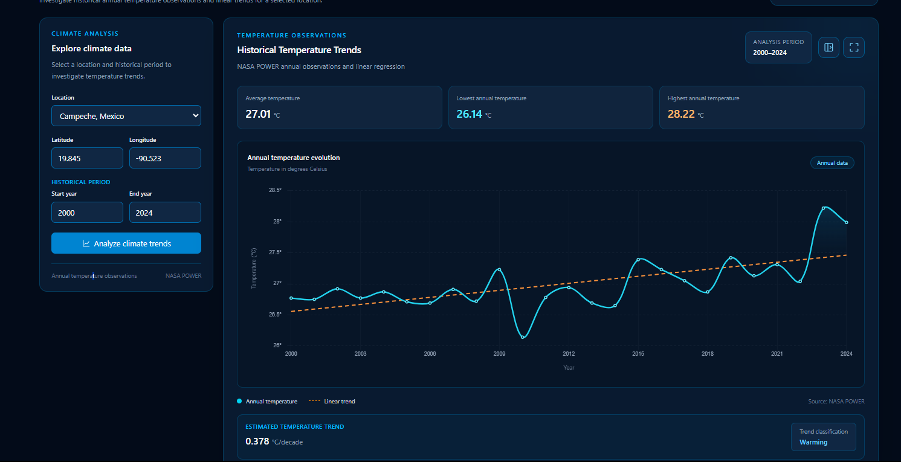
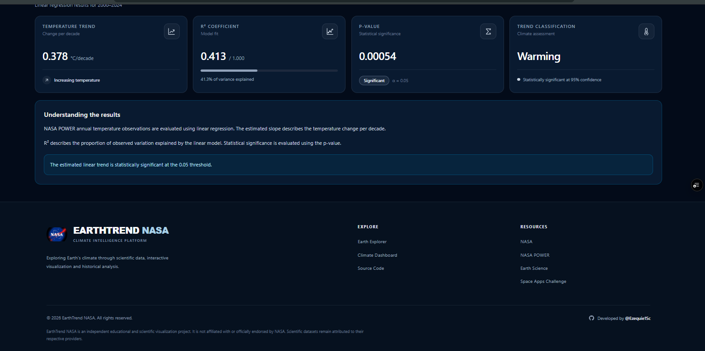
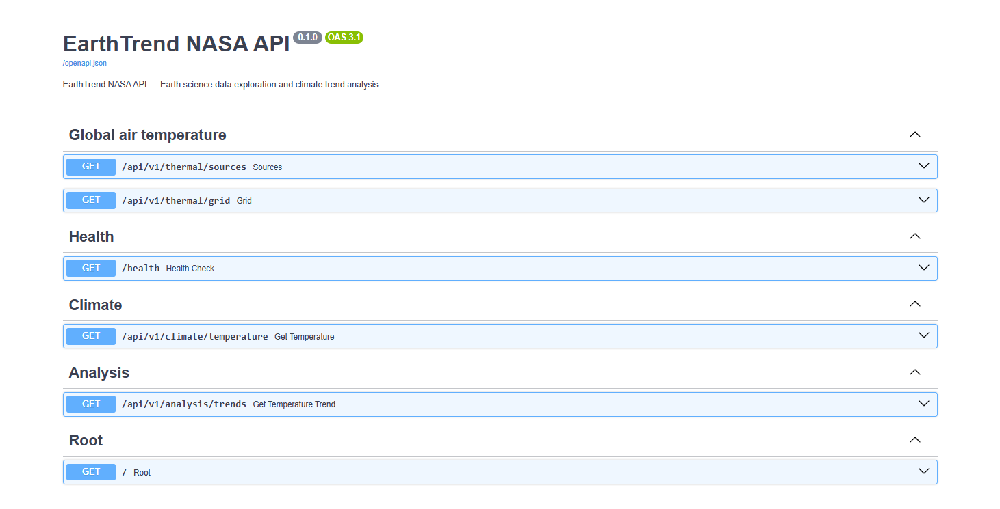

<div align="center">

# EarthTrend NASA

### Explore Earth's Climate Through Interactive Data Visualization

**An interactive platform for exploring global temperatures, climate patterns, and Earth observation data.**



[](https://angular.dev/)
[](https://www.typescriptlang.org/)
[](https://www.python.org/)
[](https://fastapi.tiangolo.com/)
[](https://threejs.org/)
[](https://power.larc.nasa.gov/)
[](https://www.noaa.gov/)

**[Live Application](https://earth-trend-nasa.vercel.app/)** |
**[API Documentation](https://earthtrend-nasa-api.onrender.com/docs)** |
**[Source Code](https://github.com/Ezequie1Sc/EarthTrend-NASA)**

</div>

---

## About the Project

**EarthTrend NASA** is a full-stack web application that transforms scientific climate data into accessible and interactive visualizations.

The platform combines a three-dimensional Earth model, global thermal visualization, climate dashboards, and trend analysis to help users explore environmental information.

Using scientific datasets from **NASA POWER** and **NOAA**, EarthTrend NASA provides a visual approach to understanding climate conditions across different geographic locations.

The application was developed with Angular 22, TypeScript, Three.js, Python, and FastAPI.

Its architecture separates scientific data retrieval, backend processing, frontend services, and interactive visualization.

### Project Objective

The primary objective of EarthTrend NASA is to make Earth science information easier to explore and understand.

Instead of requiring users to interpret complex scientific datasets directly, the platform presents climate information through geographic visualization, charts, and interactive controls.

EarthTrend NASA is designed as an educational and exploratory tool for students, developers, and people interested in climate science.

---

## The Problem

Climate and environmental information plays an important role in understanding our planet.

However, scientific datasets are frequently distributed through specialized platforms, technical documentation, and large collections of numerical measurements.

For users without experience in data analysis, these formats can be difficult to interpret.

Understanding geographic temperature distributions, climate indicators, and environmental trends often requires additional tools and technical knowledge.

### The Challenge

How can scientific climate data be transformed into an interactive experience that makes geographic patterns and environmental information easier to understand?

---

## Our Solution

EarthTrend NASA addresses this challenge by connecting scientific data sources with modern web visualization technologies.

The application retrieves environmental information through a FastAPI backend and presents the results through an Angular interface.

Users can explore a three-dimensional Earth, visualize global thermal data, inspect climate charts, and examine environmental indicators.

### What Can Users Do?

- Explore a 3D representation of Earth.
- Visualize global temperature distributions.
- Select available dates for thermal exploration.
- Examine climate charts and indicators.
- Explore location-based climate information.
- Review climate trends through visual summaries.
- Interact with scientific data without manually processing raw datasets.

The platform focuses on making climate information more accessible through visualization.

---

## Application Screenshots

The following screenshots demonstrate the main sections of EarthTrend NASA.

### 01 — Interactive 3D Earth

The Earth Explorer provides an interactive three-dimensional representation of our planet.

The visualization integrates global temperature information into a thermal overlay displayed on the Earth's surface.

Users can explore geographic temperature distributions and interact with the globe.

**Main capabilities:**

- Interactive Three.js globe.
- Global thermal visualization.
- Temperature-based color representation.
- Date selection.
- Geographic exploration.
- Interactive visualization controls.



---

### 02 — Climate Charts and Trend Analysis

The climate dashboard transforms environmental measurements into interactive charts and visual summaries.

Users can explore climate information associated with selected locations and examine patterns across available periods.

**Main capabilities:**

- Interactive climate charts.
- Location-based climate exploration.
- Climate indicators.
- Trend summaries.
- NASA POWER data integration.



---

### 03 — Climate Data and Application Overview

EarthTrend NASA also presents climate information through structured interface sections designed to support data exploration.

The application combines visual indicators, descriptive information, and a responsive layout.

This screenshot highlights the climate data presentation and the final section of the interface.



---

### 04 — FastAPI Backend and Server

EarthTrend NASA uses a Python backend developed with FastAPI and deployed on Render.

The backend provides REST API endpoints for retrieving climate information, accessing thermal datasets, performing trend analysis, and checking application availability.

FastAPI also provides interactive API documentation through Swagger UI.

**Backend responsibilities:**

- Handle requests from the Angular frontend.
- Retrieve climate information from scientific data sources.
- Process and structure thermal datasets.
- Provide temperature grids.
- Support climate trend analysis.
- Return structured JSON responses.
- Expose application health endpoints.



**Backend:** https://earthtrend-nasa-api.onrender.com/

**Swagger Documentation:** https://earthtrend-nasa-api.onrender.com/docs

---

## Key Features

### 1. Interactive Earth Visualization

The application uses Three.js to render an interactive three-dimensional globe.

The Earth Explorer combines geographic rendering with thermal data to provide a visual representation of temperature distributions.

### 2. Global Thermal Data

EarthTrend NASA retrieves global temperature grids through its backend.

The thermal visualization pipeline transforms geographic temperature measurements into color-based textures.

These textures are applied to the globe to represent global thermal patterns.

### 3. Climate Dashboard

The dashboard provides visual representations of climate measurements through charts and indicators.

It includes components for location selection, climate chart visualization, and trend summaries.

### 4. Climate Trend Analysis

The backend includes dedicated services for processing climate information and analyzing trends.

The results support the application's visual exploration features.

### 5. Scientific Data Integration

EarthTrend NASA uses data from established scientific providers:

- NASA POWER.
- NOAA.

### 6. Modular Full-Stack Architecture

The application separates its frontend and backend into independent services.

Angular handles the user interface and visualization, while FastAPI manages API endpoints and scientific data processing.

### 7. Web Worker Processing

The thermal visualization uses a Web Worker to process raster data outside the main browser thread.

This helps separate temperature texture generation from the interactive rendering interface.

---

## Technology Stack

| Layer | Technologies |
|---|---|
| Frontend | Angular 22, TypeScript |
| UI Styling | Tailwind CSS |
| 3D Visualization | Three.js |
| Climate Visualization | Interactive charts |
| Background Processing | Web Workers |
| Backend | Python, FastAPI |
| HTTP Communication | Angular HttpClient, HTTPX |
| Data Processing | Python, TypeScript |
| Scientific Data | NASA POWER, NOAA |
| Frontend Hosting | Vercel |
| Backend Hosting | Render |
| Version Control | Git, GitHub |

---

## System Architecture

EarthTrend NASA follows a modular client-server architecture.

The frontend and backend are deployed independently and communicate through REST API requests.

```text
                 SCIENTIFIC DATA SOURCES
                 ┌─────────────────────┐
                 │     NASA POWER      │
                 │        NOAA         │
                 └──────────┬──────────┘
                            │
                            ▼
                 ┌─────────────────────┐
                 │   FASTAPI BACKEND   │
                 │                     │
                 │   Climate Routes    │
                 │   Thermal Routes    │
                 │   Analysis Routes   │
                 │   Health Routes     │
                 └──────────┬──────────┘
                            │
                         REST API
                            │
                            ▼
                 ┌─────────────────────┐
                 │   ANGULAR FRONTEND  │
                 │                     │
                 │   Core Services     │
                 │   TypeScript Models │
                 │   Feature Pages     │
                 └──────────┬──────────┘
                            │
                ┌───────────┴───────────┐
                │                       │
                ▼                       ▼
       ┌─────────────────┐    ┌─────────────────┐
       │  EARTH EXPLORER │    │ CLIMATE         │
       │                 │    │ DASHBOARD       │
       │  Three.js Globe │    │                 │
       │  Thermal Layers │    │ Climate Charts  │
       │  Web Workers    │    │ Trend Summaries │
       └─────────────────┘    └─────────────────┘
```

### How It Works

1. Scientific climate information is obtained from NASA POWER and NOAA.
2. The FastAPI backend retrieves and processes the required information.
3. Backend endpoints return structured JSON data.
4. Angular services request the data through HTTP.
5. The frontend transforms the information into charts and visual indicators.
6. Thermal grid data is processed into textures for the 3D globe.
7. Users explore the resulting visualizations through the interface.

---

## Thermal Visualization Pipeline

The global thermal visualization uses a dedicated processing pipeline.

```text
NOAA Thermal Data
       |
       v
FastAPI Thermal Service
       |
       v
Global Temperature Grid
       |
       v
REST API Response
       |
       v
Angular TemperatureGridService
       |
       v
Web Worker
       |
       v
Thermal Raster Processing
       |
       v
RGBA Pixel Buffer
       |
       v
Three.js DataTexture
       |
       v
Interactive 3D Earth
```

The Web Worker performs raster processing separately from the main rendering interface.

The resulting pixel buffer is converted into a Three.js texture and used to display thermal information on the globe.

---

## Project Structure

```text
EarthTrend-NASA/
│
├── frontend/
│   ├── public/
│   │   ├── logo/
│   │   │   └── nasa-logo.webp
│   │   │
│   │   └── prueba/
│   │       ├── hero.png
│   │       ├── global.png
│   │       ├── chart.png
│   │       ├── fin.png
│   │       └── server.png
│   │
│   └── src/
│       └── app/
│           ├── app.config.ts
│           ├── app.routes.ts
│           ├── app.ts
│           │
│           ├── core/
│           │   ├── models/
│           │   │   ├── climate.model.ts
│           │   │   └── thermal.model.ts
│           │   │
│           │   └── services/
│           │       ├── api-url.ts
│           │       ├── climate-api.service.ts
│           │       └── temperature-grid.service.ts
│           │
│           └── features/
│               ├── dashboard/
│               │   ├── components/
│               │   │   ├── climate-chart/
│               │   │   ├── location-selector/
│               │   │   └── trend-summary/
│               │   │
│               │   └── pages/
│               │       └── dashboard/
│               │
│               └── earth-explorer/
│                   ├── components/
│                   │   ├── earth-globe/
│                   │   │   ├── earth-globe.ts
│                   │   │   ├── earth-globe.html
│                   │   │   ├── geography.ts
│                   │   │   ├── temperature-texture.ts
│                   │   │   ├── thermal-raster.ts
│                   │   │   └── thermal.worker.ts
│                   │   │
│                   │   └── thermal-controls/
│                   │
│                   └── pages/
│                       └── earth-explorer/
│
├── backend/
│   └── app/
│       ├── main.py
│       │
│       ├── api/
│       │   └── routes/
│       │       ├── analysis.py
│       │       ├── climate.py
│       │       ├── health.py
│       │       └── thermal.py
│       │
│       ├── core/
│       │   └── config.py
│       │
│       ├── schemas/
│       │   ├── analysis.py
│       │   ├── climate.py
│       │   └── thermal.py
│       │
│       └── services/
│           ├── nasa_power_service.py
│           ├── thermal_processing.py
│           ├── thermal_service.py
│           └── trend_analysis_service.py
│
└── README.md
```

---

## Getting Started

### Prerequisites

Make sure the following tools are installed:

- Node.js
- pnpm
- Python
- Git

### Clone the Repository

```bash
git clone https://github.com/Ezequie1Sc/EarthTrend-NASA.git
cd EarthTrend-NASA
```

### Frontend Setup

Navigate to the frontend directory:

```bash
cd frontend
```

Install dependencies:

```bash
pnpm install
```

Start the Angular development server:

```bash
pnpm start
```

Open:

http://localhost:4200

### Backend Setup

Open a second terminal from the project root.

Navigate to the backend directory:

```bash
cd backend
```

Create a virtual environment:

```bash
python -m venv .venv
```

Activate the environment on Windows PowerShell:

```powershell
.\.venv\Scripts\Activate.ps1
```

Install the backend dependencies:

```bash
pip install -r requirements.txt
```

Start the FastAPI server:

```bash
uvicorn app.main:app --reload
```

The backend will be available at:

http://127.0.0.1:8000

API documentation:

http://127.0.0.1:8000/docs

### API Configuration

The frontend currently uses the production API deployed on Render.

Configuration file:

```text
frontend/src/app/core/services/api-url.ts
```

Production API:

```typescript
const API_BASE_URL =
  'https://earthtrend-nasa-api.onrender.com/api/v1';
```

For local development, this can be changed to:

```typescript
const API_BASE_URL =
  'http://127.0.0.1:8000/api/v1';
```

Restore the production API URL before deploying the application.

---

## API Documentation

EarthTrend NASA exposes REST endpoints through FastAPI.

The backend contains four route modules.

| Module | Description |
|---|---|
| Health | Application availability and service checks |
| Climate | Climate data retrieval |
| Thermal | Thermal sources and temperature grids |
| Analysis | Climate trend analysis |

### Thermal Sources

```http
GET /api/v1/thermal/sources
```

Returns information about the available thermal data sources.

### Global Temperature Grid

```http
GET /api/v1/thermal/grid?date=2024-06-15&provider=noaa
```

Retrieves global thermal grid data for the requested date and provider.

### API Root

```http
GET /
```

Returns application information and API status.

### Swagger UI

The complete interactive API documentation is available at:

https://earthtrend-nasa-api.onrender.com/docs

---

## Scientific Data Sources

### NASA POWER

NASA POWER stands for **Prediction Of Worldwide Energy Resources**.

It provides meteorological and solar radiation information derived from scientific datasets.

EarthTrend NASA integrates NASA POWER data into its climate exploration and analysis functionality.

**Official website:** https://power.larc.nasa.gov/

### NOAA

The **National Oceanic and Atmospheric Administration** provides scientific information related to Earth's atmosphere, oceans, weather, and climate.

EarthTrend NASA uses NOAA-based thermal data for its global temperature visualization.

**Official website:** https://www.noaa.gov/

### Scientific Interpretation

EarthTrend NASA is intended for educational exploration and climate data visualization.

The available measurements, dates, geographic coverage, and temporal resolution depend on the underlying datasets.

The application should not be interpreted as a real-time weather monitoring system unless a particular dataset explicitly supports that use.

---

## Deployment

The application is deployed using separate services.

### Frontend — Vercel

The Angular frontend is hosted on Vercel.

**Live Application:**

https://earth-trend-nasa.vercel.app/

### Backend — Render

The FastAPI backend is hosted on Render.

**Backend URL:**

https://earthtrend-nasa-api.onrender.com/

**Interactive Documentation:**

https://earthtrend-nasa-api.onrender.com/docs

### API Communication

The frontend communicates with the backend through HTTPS REST requests.

The backend includes CORS configuration for the production frontend, local development, and project-specific Vercel preview deployments.

---

## Testing

The Angular project includes test files for the application and thermal visualization components.

Examples:

```text
frontend/src/app/app.spec.ts

frontend/src/app/features/earth-explorer/components/earth-globe/earth-globe.spec.ts

frontend/src/app/features/earth-explorer/components/earth-globe/thermal-raster.spec.ts
```

These files support testing of frontend behavior and thermal processing functionality.

---

## Future Improvements

Possible future enhancements include:

- Additional NASA Earth observation datasets.
- Expanded historical climate comparisons.
- More environmental indicators.
- Additional geographic visualization controls.
- Exportable climate reports.
- Improved mobile interactions.
- Expanded automated testing.
- More advanced data analysis capabilities.

These are proposed improvements rather than completed features.

---

## Project Impact

EarthTrend NASA demonstrates how scientific data and modern web technologies can be combined to create accessible environmental exploration tools.

The project aims to:

- Encourage interest in Earth science.
- Make climate information easier to interpret.
- Support interactive exploration of environmental data.
- Demonstrate practical scientific data integration.
- Promote the use of visualization in education and technology.

The platform is an educational and exploratory application, not an official climate forecasting or scientific research product.

---

## Developer

**Ezequiel Salazar**

Computer Systems Engineering Student  
Full-Stack Developer

**GitHub:** https://github.com/Ezequie1Sc

---

## Acknowledgments

EarthTrend NASA uses scientific resources and open-source technologies from:

- [NASA POWER](https://power.larc.nasa.gov/)
- [NOAA](https://www.noaa.gov/)
- [Angular](https://angular.dev/)
- [Three.js](https://threejs.org/)
- [FastAPI](https://fastapi.tiangolo.com/)
- [Vercel](https://vercel.com/)
- [Render](https://render.com/)

EarthTrend NASA is an independent educational software project and is not an official NASA or NOAA application.

---

<div align="center">

### EarthTrend NASA

**Exploring our planet through data.**

[Live Application](https://earth-trend-nasa.vercel.app/) |
[API Documentation](https://earthtrend-nasa-api.onrender.com/docs) |
[GitHub](https://github.com/Ezequie1Sc/EarthTrend-NASA)

</div>
